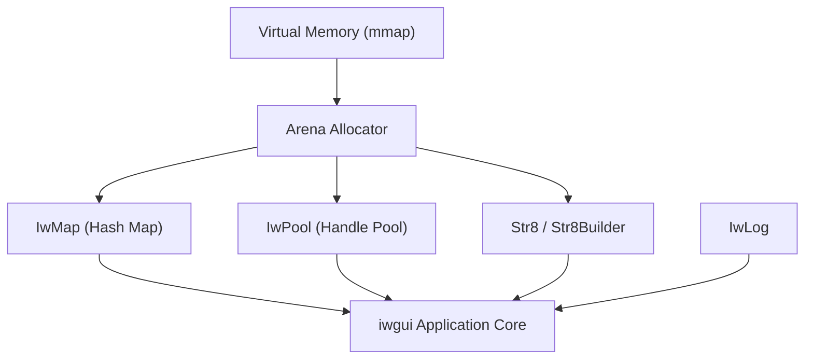

# iwgui

Lightweight, modern C23 base library and immediate-mode GUI foundation for wireless management (iwd).

## Features

- **Linear & Temp Allocator (`Arena`)**: Virtual memory reserve and lazy page commit with temporary scopes and scratch arena pools.
- **Generational Pool (`IwPool`)**: Slot-map handle allocator with generational indices preventing stale reference bugs.
- **String Slices (`Str8`)**: Non-owning UTF-8 string views, dynamic builders, formatted printing, and robust parsing.
- **Fast Hash Table (`IwMap`)**: Arena-backed open-addressing hash table with backward-shift deletion.
- **Leveled Logging (`IwLog`)**: Tagged output with configurable verbosity and ANSI color support.
- **Secure Memory Utilities**: Zeroing sensitive data such as Wi-Fi passphrases via `explicit_bzero`.

## Architecture Overview



## Directory Structure

```text
iwgui/
├── meson.build          # Meson build definitions (C23 / GNU23)
├── src/
│   └── base/            # Core base abstractions
│       ├── arena.c/h    # Arena and scratch allocators
│       ├── log.c/h      # Leveled logger
│       ├── map.c/h      # Arena-backed hash map
│       ├── memsec.h     # Secure memory clearing
│       ├── pool.c/h     # Generational slot pool
│       ├── str.c/h      # String slices and builder
│       └── types.h      # Primitive aliases and assertions
└── tests/
    └── test_base.c      # Unit test suite
```

## Building & Testing

Prerequisites:
- Meson (>= 1.4.0)
- Ninja
- GCC or Clang with C23 (`-std=gnu23`) support

```bash
# Setup build directory
meson setup build

# Compile
meson compile -C build

# Run unit tests
meson test -C build -v
```
